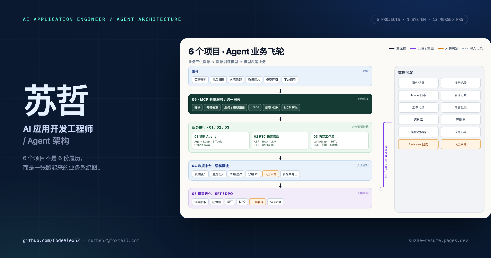

# 苏哲 · 个人简历站



深色单页简历站，服务于 AI 应用开发 / Agent 架构岗位投递。首屏是一张可点击的 Agent 业务系统架构图，部署在 Cloudflare Pages；国内多数网络可直连，如遇个别运营商 DNS 污染或晚高峰波动，绑定自定义域名即可绕开 `pages.dev` 域名层。

线上地址：**https://suzhe-resume.pages.dev**

源码：https://github.com/CodeAlex52/resume-site

## 特点

- **首屏系统架构图**：按泳道画出 6 个项目如何互成飞轮 —— 事件 → 06 MCP 平台 → 01/02/03 业务执行 → 04 数据中台 → 05 模型进化，右侧数据沉淀，四类连线（主流程 / 反哺重派 / 人的决定 / 写入记录）都有图例。
- **可点击**：点架构图里的 01–06 标题，直接打开该项目的 runtime 链路抽屉，看到每一步实现、源码位置与 EVIDENCE。
- **轻正文**：主页面只保留项目一句话 + 关键指标；完整描述、要点、链路与证据收进抽屉。
- **全端自适应**：桌面展示横向泳道图；平板/手机切换为纵向泳道，不靠横向滚动也能读完整个架构。
- **零外部依赖**：无 CDN、无 Google Fonts、无构建步骤；纯 HTML/CSS/SVG/JS。
- **可打印**：内置 print 样式，浏览器直接打印 / 导出 PDF 也可读。

## 目录

```text
site/
├── index.html          # 页面结构 + 桌面 SVG 架构图 + 移动端纵向泳道
├── styles.css          # 深色外壳 + 浅色架构图纸 + 抽屉 + 响应式 + 打印
├── data.js             # 6 个项目详情 + 运行链路节点 + 飞轮元数据
├── app.js              # 架构图点击 / 抽屉渲染 / 节点交互 / 导航高亮
├── assets/
│   ├── suzhe-resume.pdf
│   └── og.png
├── _headers            # Cloudflare Pages 安全与缓存响应头
├── robots.txt
└── sitemap.xml
```

## 本地预览

```bash
cd site
python3 -m http.server 4173
# 打开 http://127.0.0.1:4173
```

## 更新内容

- 架构图的泳道 / 箭头 / 文案：直接改 `index.html` 里的桌面 SVG 与 `.arch-mobile` 纵向泳道。
- 项目卡片一句话 / 指标：改 `index.html` 的 `.pcard`；抽屉里的小标签仍用 `data.js` 的 `FLYWHEEL_META`。
- 项目详情与运行链路：改 `data.js` 里的 `nodes`；字段为 `code / layer / title / label / endpoint / desc / source`。
- 替换简历 PDF：覆盖 `assets/suzhe-resume.pdf`。
- 替换社交分享图：覆盖 `assets/og.png`（建议 1200×630）。

## 部署

Cloudflare Pages 项目 `suzhe-resume` 已创建并绑定 `main` 为生产分支。后续更新：

```bash
npx wrangler pages deploy . --project-name suzhe-resume --branch main
```

首次创建项目（本仓库已完成，无需重复）：

```bash
# 若 wrangler 把项目创建成 Worker，请在 Cloudflare Dashboard
# Workers & Pages → Create → Pages → Direct Upload 新建名为 suzhe-resume 的项目
npx wrangler pages deploy . --project-name suzhe-resume --branch main
```

## 口径

- KEY RESULTS 数字为生产口径（来源：简历）。
- EVIDENCE 行标注本地可复现边界；本地未验证的部分明确写「未执行 / 目标态」。
- 不宣称 P6 已完成 Serverless 真机部署；当前为 Docker Compose，同一镜像不同启动命令。
